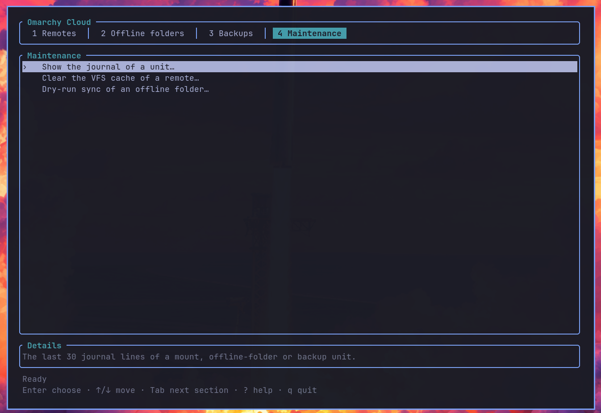

# Omarchy Cloud

Omarchy Cloud shows your cloud storage (Google Drive, OneDrive, Dropbox and many
more) as ordinary folders on your [Omarchy](https://omarchy.org) desktop, in
`~/Cloud`. A small cloud icon on the bar shows what is connected. You can also
keep a cloud folder **synced offline** on your computer, and keep dated
**backup** copies of important files (single files, not folders).


Nothing is turned on by installing. You add each drive, synced folder and backup
yourself, step by step, in a small terminal app.

## Words used in these docs

| Word | Meaning |
|---|---|
| **remote** | Your Google Drive (or OneDrive, Dropbox…) as the program behind this plugin, rclone, calls it. You choose its name when you add it, for example `gdrive`. |
| **mount** | Making a remote show up as a folder you can open. Files are fetched when you open them. |
| **mount folder** | The one folder on your computer where all mounts appear, `/mnt/cloud` by default. Each remote shows up inside it, and `~/Cloud/<remote>` is a shortcut (link) to it. The installer and the panel call it the "mount root". |
| **offline folder** | A folder on your computer kept in two-way sync with a folder on a remote, so the files are there without a connection. |
| **backup** | Dated copies of important files (single files, not folders): a schedule downloads the files you chose from a remote and keeps several dated copies of each on your computer. |
| **Omarchy Cloud app** | The terminal program where you set all of the above up. |
| **panel** | The Omarchy Cloud panel: the popup that opens when you click the cloud icon on the bar. |
| **installed parts** | The small helper programs and settings files the plugin needs. The installer copies them into your home folder; the panel calls them "installed parts". |

More technical words (sudo, systemd, FUSE, VFS cache…) are in the
[glossary](docs/glossary.md).

## What you need

- An Omarchy desktop (it provides the bar and the other tools used here).
- **rclone**, a free program that talks to cloud services. This plugin uses it
  behind the scenes. Check whether you have it with `rclone --version`. If not,
  install it together with three small helpers it needs (`fuse3` for mounting,
  `psmisc` to tell you which programs are using a drive, `libnotify` for desktop
  notifications):

  ```bash
  sudo pacman -S --needed rclone fuse3 psmisc libnotify
  ```

  `sudo` runs a command as the computer's administrator and asks for your
  password (see the [glossary](docs/glossary.md#sudo)). This installs standard
  packages from Arch's official repositories; packages you already have are
  skipped.

## Install

1. Add the plugin to Omarchy. This downloads it to
   `~/.config/omarchy/plugins/io.github.rsd.cloud-mounts` and puts a cloud icon
   on the right of the bar:

   ```bash
   omarchy plugin add https://github.com/rsd/omarchy-cloud-plugin.git --enable
   ```

   If the plugin is listed in the Omarchy plugin marketplace you can add it from
   there instead. Either way you still do step 2: adding the plugin does not
   install its helper files.

   No cloud icon? See [troubleshooting](docs/troubleshooting.md#i-do-not-see-the-cloud-icon-on-the-bar).

2. Click the cloud icon. The panel says **Installed parts: not installed** and
   shows a **Set up…** button. Click it. A small terminal window opens and runs
   the installer. **Do not close it.** It copies the helper files into your home
   folder, then asks where to put your cloud drives (next section). At the very
   end it waits for you to press Enter.

   Prefer the keyboard? Run the same installer yourself:

   ```bash
   cd ~/.config/omarchy/plugins/io.github.rsd.cloud-mounts
   ./install.sh
   ```

   You will see a line `installed …` for each file, then the mount folder
   question (next section), then `install.sh: done; nothing was enabled`.

To update or remove the plugin later, see [docs/install.md](docs/install.md).
Uninstalling is one command and keeps your files.

## One-time step: the mount folder

The installer asks where your cloud drives should appear:

```
Mount root [/mnt/cloud] (Enter to accept, or type another path):
```

Press Enter to accept `/mnt/cloud`. If that folder does not exist yet (usual on a
fresh computer), the installer prints one short command that creates it and
waits. This is the only moment the plugin needs administrator rights, and you
run the command yourself. It is safe: it creates one empty folder and nothing
else. **Step-by-step instructions, including how to open a second terminal and
what the password prompt looks like, are in
[docs/mount-folder.md](docs/mount-folder.md#create-the-mount-folder-step-by-step).**

Why the folder is outside your home folder (and cannot be a link into it): so search
and backup tools do not try to read your whole cloud drive. The full reason is in
[docs/mount-folder.md](docs/mount-folder.md#why-it-is-outside-your-home-folder).

## First steps

1. Open the Omarchy Cloud app: click **Configure…** in the panel (or type
   `omarchy-cloud` in a terminal). It starts on the **Remotes** section. The keys
   you can press are always listed on the bottom line, `?` shows help and `q`
   quits.

   

2. Press `a` to add a remote. The app hands the screen to rclone's own question
   screen. For Google Drive, answer it exactly as in
   [Add Google Drive](docs/remotes.md#add-google-drive-step-by-step); other
   services are similar.
3. When rclone finishes, the app mounts the new remote and shows a message like
   `gdrive mounted, ~/Cloud/gdrive linked`.
4. Open your files: click the folder icon next to the remote in the panel, or open
   `~/Cloud/gdrive` (use your remote's name) in the file manager. If it looks
   empty, wait a few seconds and press `r` in the app to refresh.

The switch next to a remote in the panel mounts and unmounts it. Remotes set to
"Start at login" mount by themselves when you log in. If anything goes wrong, see
[troubleshooting](docs/troubleshooting.md).

Next, when you want them:

- Keep a folder available offline: [docs/offline-folders.md](docs/offline-folders.md)
- Keep dated copies of important files (single files, not folders): [docs/backups.md](docs/backups.md)
- Read the log of something that failed, or free the disk space a remote uses for
  its cache: the **Maintenance** section (key `4`), described in
  [docs/tui.md](docs/tui.md#maintenance).

  

## Documentation

**Getting started**

| Read | For |
|---|---|
| [docs/install.md](docs/install.md) | Requirements, install options, updating, uninstalling |
| [docs/mount-folder.md](docs/mount-folder.md) | The mount folder: step-by-step setup, why, changing it |

**Using it**

| Read | For |
|---|---|
| [docs/remotes.md](docs/remotes.md) | Adding Google Drive, mounting, unmounting, removing |
| [docs/offline-folders.md](docs/offline-folders.md) | Two-way synced folders and conflict copies |
| [docs/backups.md](docs/backups.md) | Backups: dated copies of important files (single files) |
| [docs/panel.md](docs/panel.md) | The bar icon and its panel |
| [docs/tui.md](docs/tui.md) | The Omarchy Cloud app: every section and key |

**If something goes wrong**

| Read | For |
|---|---|
| [docs/troubleshooting.md](docs/troubleshooting.md) | Fixes, listed by symptom |
| [docs/faq.md](docs/faq.md) | Short answers |

**For the curious, and for developers**

| Read | For |
|---|---|
| [docs/glossary.md](docs/glossary.md) | Technical words explained |
| [docs/how-it-works.md](docs/how-it-works.md) | systemd units, files written, safety and security, installer details |
| [docs/reference.md](docs/reference.md) | Config files, commands, exit codes, state files |
| [docs/development.md](docs/development.md) | Building, tests, releasing, marketplace notes |

## License

MIT, see [LICENSE](LICENSE).
