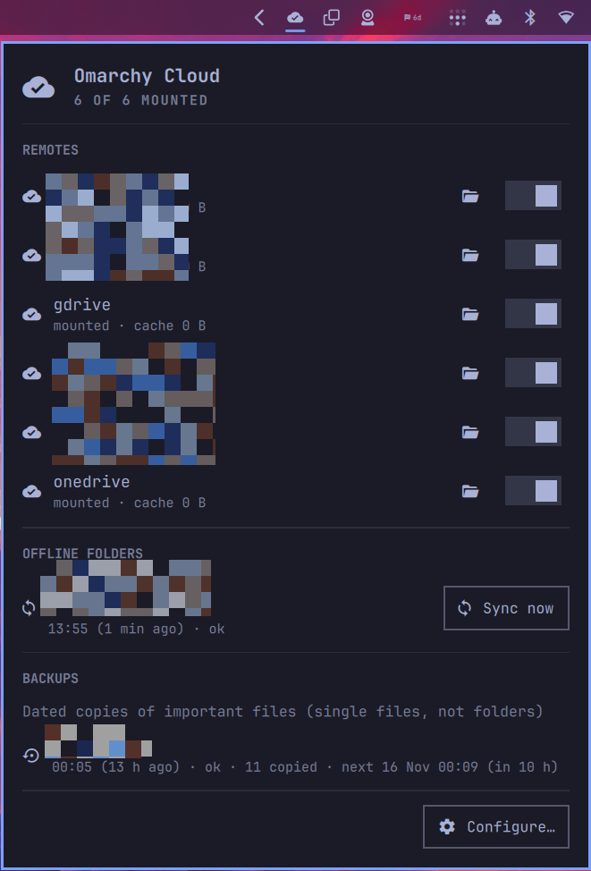
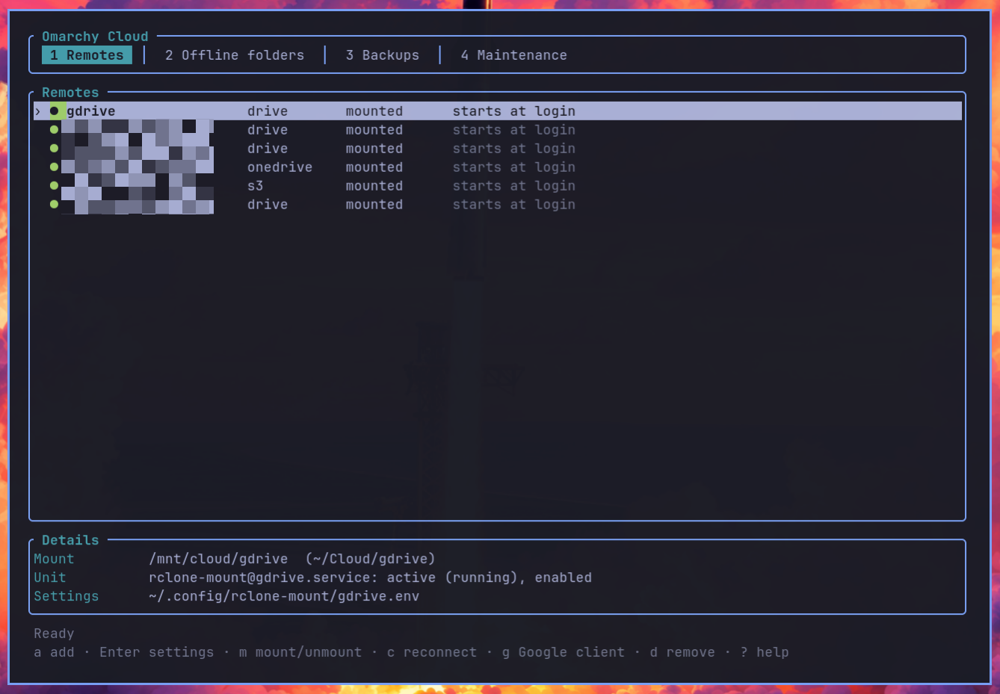

# Omarchy Cloud

Omarchy Cloud lets you see your cloud storage (Google Drive, Dropbox, OneDrive
and the many other services rclone supports) as an ordinary folder on your
computer. You open your cloud files with your normal apps, choose folders to keep
available offline, and make dated backup copies of chosen files. It is for people
who keep files in the cloud and want them to behave like local files on
[Omarchy](https://omarchy.org).

The mounting itself, showing the cloud as a folder, is done by
[rclone](https://rclone.org), a free open-source program. Omarchy Cloud is the
control panel that sets it up and keeps an eye on it.



## rclone does the real work

This plugin does not talk to the cloud itself. The connection is made by
**[rclone](https://rclone.org)**, a well-known, free, open-source tool that signs
in to your cloud account and shows it as a folder. Omarchy Cloud is a friendly
control panel around rclone: it sets rclone up, starts it, watches it, and shows
its status in a small cloud icon on the Omarchy bar. rclone is installed
separately (see [What you need](#what-you-need)).

Nothing is turned on by installing. You add each drive, offline folder and backup
yourself, and you confirm each step.

## What you need

- An Omarchy desktop (it provides the bar and the other tools used here).
- **rclone**, plus three small helpers it needs. Check whether you already have
  rclone with `rclone --version`. If not, install them all with:

  ```bash
  sudo pacman -S --needed rclone fuse3 psmisc libnotify
  ```

  `sudo` runs a command as the computer's administrator and asks for your
  password (see the [glossary](docs/glossary.md#sudo)). `pacman` installs
  standard packages from Arch's official repositories and skips any you already
  have. `fuse3` lets rclone show a drive as a folder, `psmisc` tells you which
  programs are using a drive, and `libnotify` shows desktop notifications.

## Install

1. Add the plugin to Omarchy. This downloads it to
   `~/.config/omarchy/plugins/io.github.rsd.cloud-mounts` and puts a cloud icon
   on the right of the bar:

   ```bash
   omarchy plugin add https://github.com/rsd/omarchy-cloud-plugin.git --enable
   ```

   If the plugin is listed in the Omarchy plugin marketplace you can add it from
   there instead. Either way you still do step 2: adding the plugin does not
   install its helper files.

   No cloud icon? See [troubleshooting](docs/troubleshooting.md#i-do-not-see-the-cloud-icon-on-the-bar).

2. Click the cloud icon. The panel says **Installed parts: not installed** and
   shows a **Set up…** button. Click it. A small terminal window opens and runs
   the installer. **Do not close it.** It copies the helper files into your home
   folder, asks where to put your cloud drives (next section), and at the end
   waits for you to press Enter.

   Prefer the keyboard? Run the same installer yourself:

   ```bash
   cd ~/.config/omarchy/plugins/io.github.rsd.cloud-mounts
   ./install.sh
   ```

   It ends with `install.sh: done; nothing was enabled`.

To update or remove the plugin later, see [docs/install.md](docs/install.md).
Uninstalling is one command and keeps your files.

## One-time step: the mount folder

The installer asks where your cloud drives should appear:

```
Mount root [/mnt/cloud] (Enter to accept, or type another path):
```

Press Enter to accept `/mnt/cloud`. If that folder does not exist yet (usual on a
fresh computer), the installer prints one short command that creates it and
waits for you to run it. This is the only moment administrator rights are needed,
and you run the command yourself: it creates one empty folder and nothing else.
Step-by-step help is in
[docs/mount-folder.md](docs/mount-folder.md#create-the-mount-folder-step-by-step).
The folder is outside your home folder so search and backup tools do not try to
read your whole cloud drive
([why](docs/mount-folder.md#why-it-is-outside-your-home-folder)).

## First-time setup

1. Click **Configure…** in the panel (or type `omarchy-cloud` in a terminal) to
   open the Omarchy Cloud app. The keys you can press are listed on the bottom
   line; `?` shows help and `q` quits.

   

2. Press `a` to add a cloud account. The app hands the screen to rclone's own
   question screen. For Google Drive, answer it as in
   [Add Google Drive](docs/remotes.md#add-google-drive-step-by-step); other
   services work the same way. You sign in on the service's own web page, so
   the plugin never sees your password.
3. When rclone finishes, the app mounts the drive and shows a message like
   `gdrive mounted, ~/Cloud/gdrive linked`.
4. Open your files: click the folder icon next to the drive in the panel, or open
   `~/Cloud/gdrive` (use your own drive's name) in the file manager. If it looks
   empty, wait a few seconds and press `r` in the app to refresh.

## Everyday use

- **Open cloud files** from `~/Cloud/<name>` with any app. Files are fetched when
  you open them. The switch next to a drive in the panel mounts and unmounts it,
  and drives set to "Start at login" mount by themselves.
- **Keep a folder offline.** An offline folder is kept in two-way sync with a
  folder in the cloud, so the files are on your disk without a connection. If a
  file changes on both sides, both versions are kept and you are told. See
  [docs/offline-folders.md](docs/offline-folders.md).
- **Make backups.** A backup downloads the single files you choose on a schedule
  and keeps several dated copies of each. See [docs/backups.md](docs/backups.md).
- **Check on things.** The cloud icon shows whether everything is connected and
  flags problems. The **Maintenance** section of the app (key `4`) shows logs and
  frees the disk space a drive uses for its cache
  ([details](docs/tui.md#maintenance)).

## Limits and safety

- Nothing is installed, mounted, synced or scheduled without you clicking or
  confirming it. The installer never runs `sudo` itself.
- Deleting a file in a mounted folder deletes it in the cloud, as on the service's
  website. Offline folders sync both ways, so a deletion on one side happens on
  the other. Removing a drive, offline folder or backup in the app never deletes
  any files.
- Backups copy single files, not whole folders, and only download: they never
  change your cloud files.
- Since 0.3.7 a backup refuses a destination folder that other users of the
  computer can change, because they could use it to overwrite your files. A folder
  the backup creates for you is private from the start, such as
  `~/Backups/documents`. If a backup is refused, see
  [troubleshooting](docs/troubleshooting.md#a-backup-is-refused-invalid-configuration-or-dest-is-writable-by-other-accounts).
- It needs an internet connection to reach the cloud, apart from offline folders,
  which sync when you are back online.

## Words used in these docs

| Word | Meaning |
|---|---|
| **remote** | Your Google Drive (or OneDrive, Dropbox…) as rclone calls it. You choose its name when you add it, for example `gdrive`. |
| **mount** | Making a remote show up as a folder you can open. |
| **mount folder** | The one folder where all mounts appear, `/mnt/cloud` by default. `~/Cloud/<remote>` is a shortcut to each one. The installer and panel also call it the "mount root". |
| **offline folder** | A folder on your computer kept in two-way sync with a folder on a remote. |
| **backup** | Dated copies of chosen files, downloaded on a schedule. |
| **panel** | The popup that opens when you click the cloud icon on the bar. |
| **Omarchy Cloud app** | The terminal program where you set everything up. |
| **installed parts** | The helper programs and settings files the installer copies into your home folder. |

More technical words (sudo, systemd, FUSE, VFS cache…) are in the
[glossary](docs/glossary.md).

## Learn more

- [docs/install.md](docs/install.md): requirements, install options, updating, uninstalling
- [docs/mount-folder.md](docs/mount-folder.md): the mount folder, step by step
- [docs/remotes.md](docs/remotes.md): adding Google Drive, mounting, unmounting, removing
- [docs/offline-folders.md](docs/offline-folders.md): two-way synced folders and conflict copies
- [docs/backups.md](docs/backups.md): dated copies of important files
- [docs/panel.md](docs/panel.md): the bar icon and its panel
- [docs/tui.md](docs/tui.md): the Omarchy Cloud app, every section and key
- [docs/troubleshooting.md](docs/troubleshooting.md): fixes, listed by symptom
- [docs/faq.md](docs/faq.md): short answers
- [docs/glossary.md](docs/glossary.md): technical words explained
- [docs/how-it-works.md](docs/how-it-works.md): systemd units, files written, safety and security
- [docs/reference.md](docs/reference.md): config files, commands, exit codes, state files
- [docs/development.md](docs/development.md): building, tests, releasing, marketplace notes

## License

MIT, see [LICENSE](LICENSE).
