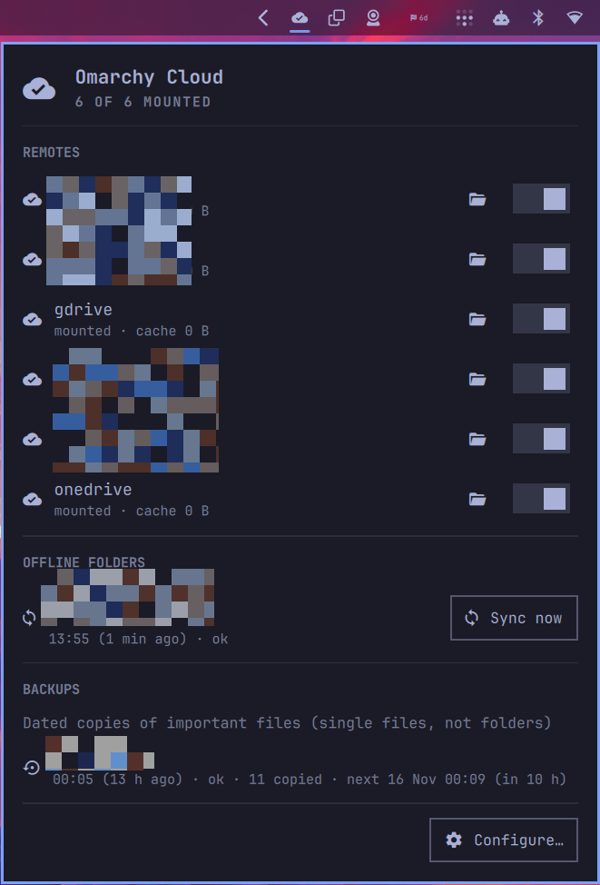

# The bar icon and the Omarchy Cloud panel

The cloud icon sits on your bar. A **left-click** opens the **panel**, a popup
with everything at a glance and the common actions. A **right-click** opens the
Omarchy Cloud app ([tui.md](tui.md)), the same as the panel's **Configure…**
button (until the app is installed, a right-click opens the panel).

The panel shows things and does the everyday actions (mount, unmount, open a
folder, sync now, show a log). You set things up in the app. The panel never
changes your configuration.

## The icon

- A cloud with a check: every remote is mounted.
- A plain cloud: some are mounted.
- A crossed-out, dimmed cloud: none are mounted.
- A cloud with an alert, in the theme's alert colour: a mount has failed (or is
  failing and retrying), a sync or a backup has failed, or a conflict copy exists.

A small badge on the icon means the helper files need attention (see "Setup
notices" below). The tooltip says how many remotes are mounted and names what
failed (lines such as "Mount failed:", "Sync failed:", "Backup failed:", "<name>: N
conflict copies").

## The panel

- **Top line.** Counts what is wrong, e.g. "3 of 3 mounted · 1 sync failed · 2
  conflict copies".
- **Remotes.** One row per remote: its name, its state (mounted, stopped, failed,
  starting, stopping), the disk space its cache takes, a **switch** to mount or
  unmount, a **folder button** (while mounted) that opens `~/Cloud/<remote>` in the
  file manager, and, for a failed mount, a button that shows its last 20 log
  lines.
- **Offline folders.** One row per offline folder: the last sync (time and result)
  and a **Sync now** button. Sync now works while syncing is on for that folder;
  otherwise the row says "Sync not enabled" in the alert colour and the button is
  disabled. After a failed run there is a "show log" button. If the folder watch or
  timer is on but stopped, the row says "Folder watch stopped (…)" or "Timer
  stopped (…)" with the commands that restart it (or press `w` in the app). The
  folder's conflict copies are listed (at most 5 named, then a count).
- **Backups.** Dated copies of important files (single files, not folders). One row per backup: the last run and the next scheduled run; a
  "show log" button after a failed run.
- Sections with nothing to show are hidden; with nothing at all, a hint ("Nothing set up yet: no mounts, offline folders or
  backups (dated copies of important files).") points to
  **Configure…**. Rows are capped at 16 per section ("Showing 16 of N") and
  remotes at 32. The panel is capped in height and scrolls past it.
- **Configure…** (bottom) opens the app in a small terminal window. If the app is
  missing, a dim hint says "Run install.sh from the plugin folder to install
  omarchy-cloud."

### Setup notices

At the bottom of the panel, one notice and button may appear:

| You see | What it means | What to do |
|---|---|---|
| "Installed parts: not installed — run install.sh" and **Set up…** | The plugin was added, but its helper files (the "installed parts") were not copied yet | Click **Set up…**: a terminal runs the installer and asks the questions |
| "Mount root not set up: …" and **Set up…** | The [mount folder](mount-folder.md) does not exist yet, its setting is missing or invalid, or it leads into your home through a link. The notice names the folder and shows the one-time command. For an invalid setting it reads "Mount root not set up: the setting … in ~/.config/omarchy-cloud/cloud.env is not a valid root — run Set up…". If the folder is a symbolic link into your home it reads "Mount root not set up: <folder> resolves inside your home (through a symbolic link): programs that crawl the home (file search, indexers, backups) would follow it into the cloud drive — run Set up… and choose a real folder outside your home" | Click **Set up…** (the installer asks), or follow [the step-by-step](mount-folder.md#create-the-mount-folder-step-by-step) |
| "Installed parts are … , plugin is …" or "…(no version recorded)" and **Update installed parts** | The plugin was updated but the helper files are older | Click **Update installed parts** |

If several apply, the order is: not installed, mount folder not set up, out of
date. **Set up…** and **Update installed parts** both just run the installer in a
terminal and close the panel; nothing happens without your click. The notice
clears a few seconds after the installer finishes (or after you create the
folder). More in [install.md](install.md#updating).

## Using the keyboard

Once the panel is open you can use the keyboard: the first arrow key shows a
cursor; Up/Down move between rows, Left/Right between a row's buttons, Enter or
Space press the highlighted one, Esc closes. The mouse moves the same cursor.

## Unmounting a remote that is in use

The row lists the programs using it and the waiting uploads, and offers **Force
unmount** (or **Unmount**) and **Cancel**, or **Stop anyway** when the check could
not run. See [remotes.md](remotes.md#unmounting-something-in-use).

## What the panel never does

The panel never runs rclone, never changes your configuration, never deletes
anything and never closes your programs. The full list is in
[how-it-works.md](how-it-works.md#safety-and-security-notes).
