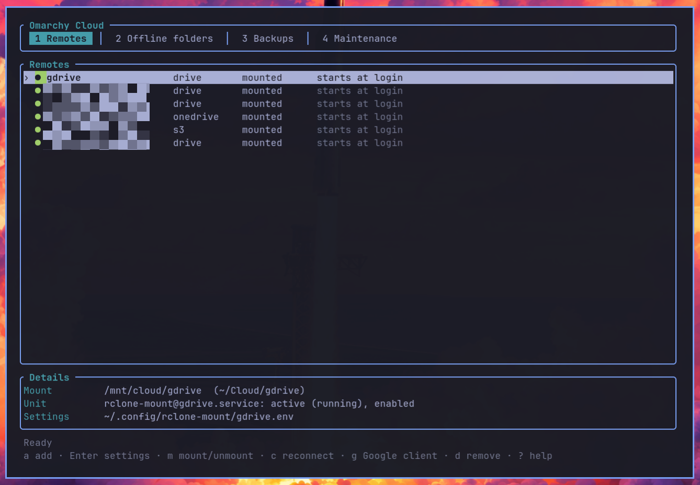
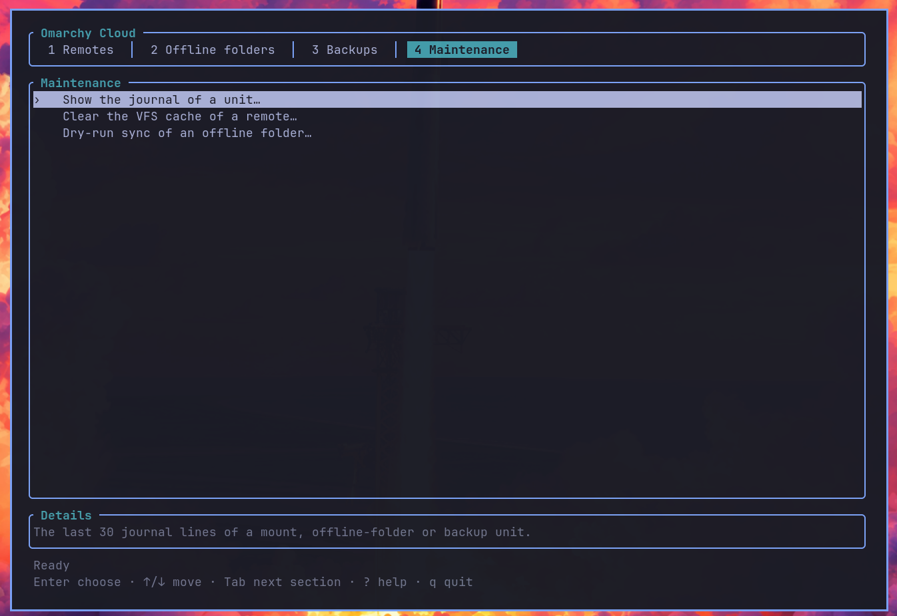

# The Omarchy Cloud app

The Omarchy Cloud app is a terminal program where you set up everything: remotes
and their mounts, offline folders and backups. Open it with **Configure…** in the
[panel](panel.md), a right-click on the bar icon, or by typing `omarchy-cloud` in
a terminal. If the terminal says the command is not found, open a new terminal, or
run it by its full path, `~/.local/bin/omarchy-cloud`.

It has four sections, shown as tabs at the top:

1. **Remotes**: see [remotes.md](remotes.md)
2. **Offline folders**: see [offline-folders.md](offline-folders.md)
3. **Backups**: see [backups.md](backups.md)
4. **Maintenance**: below

The bottom line always shows the keys of the current section. Press `?` for help.
This page is the one place where all the keys are listed.

## Keys that work everywhere

| Key | Does |
|---|---|
| Tab, Left/Right, `h`/`l`, or `1`-`4` | Switch section |
| Up/Down or `j`/`k` | Move |
| `r` | Refresh |
| `?` | Show help (any key closes it). It lists the keys of every section, including the files list screen; it works on the main screens, not inside the files list |
| `q` or Esc | Quit (`q` waits for a running task) |
| Ctrl-C | Quit and stop a running task (see [how-it-works.md](how-it-works.md#stopping-a-task-with-ctrl-c)) |

In forms: Up/Down choose the field, Left/Right choose among options, Enter saves,
Esc cancels, Ctrl-U clears the field, and a paste never submits the form. Dialogs
start on **Cancel**. Long commands run in the background with a spinner; while one
runs, other actions say "Busy" and wait.

## Remotes

The details box shows the mount path (and its `~/Cloud` link), the background
service and its state, and the settings file.

| Key | Does |
|---|---|
| `a` | Add a remote: hands the screen to rclone's question screen ([walkthrough](remotes.md#add-google-drive-step-by-step)), then mounts it and creates the `~/Cloud/<remote>` link |
| Enter / `s` | Mount settings (cache, polling, Start at login); a restart is offered |
| `m` | Mount / unmount. A mount is refused, with the setup steps, while the mount folder is not set up. An unmount asks first when files are open or uploads are waiting; a count that cannot be made counts as waiting |
| `c` | Reconnect (sign in again) |
| `g` | Your own Google client id and secret (Google Drive only; [when you need it](remotes.md#your-own-google-drive-client-usually-not-needed)) |
| `d` | Remove: refuses while files are open, asks when uploads are waiting. Deleting the remote in rclone needs a separate typed-name confirmation and is refused while an offline folder or a backup uses the remote |

## Offline folders

| Key | Does |
|---|---|
| `a` | Add: remote, cloud folder, local folder, include patterns, then a **check** (see [offline-folders.md](offline-folders.md#add-one-the-easy-way-first)) |
| Enter | Sync now. On a paused folder: resume (or check and start) |
| `p` | Pause / resume |
| `n` | Dry run: shows what a sync would do and changes nothing |
| `c` | List conflict copies |
| `w` | Restart a stopped folder watch or timer; the row shows "stopped" in red when one is on but not running |
| `d` | Remove (never deletes files) |

The settings form's restart asks the same way as an unmount when files are open
or uploads are waiting.

## Backups

A backup keeps dated copies of important files: **single files, not folders**.

| Key | Does |
|---|---|
| `a` / `e` | Add / edit |
| `f` | Open the [files list screen](#the-files-list-screen): the single files this backup copies (see [backups.md](backups.md#add-one)) |
| Enter | Run now |
| `p` | Schedule on / off |
| `d` | Remove (keeps the destination and the files list) |

### The files list screen

It opens with `f` on a backup, and by itself right after you create a backup.

| Key | Does |
|---|---|
| Up/Down or `j`/`k`, Home/End | Move, or jump to the first / last entry |
| `a` | Add a path |
| Enter | Edit the selected path |
| `d` | Remove the selected path (no question; nothing is written until you save) |
| `s` | Save, then check the backup (and set it up). Refused while an entry shows `✗` or the list is empty |
| `E` | Open the list in `$VISUAL` / `$EDITOR` instead. Refused while you have unsaved changes |
| Esc or `q` | Close. With unsaved changes it asks first: Esc or `q` again discards them, `s` saves, any other key goes back |

While you type a path: Enter keeps it, Esc goes back without it, Backspace deletes a
character, Ctrl-U clears the line, and a paste works. The path is checked as you
type: `✓ copied as <job>@<stem>.<date><ext>` shows the name of the copies, and `✗`
and a reason means it cannot be used (see [backups.md](backups.md#add-one)).

A list that is a symlink, is not UTF-8 text or is over 1 MiB cannot be shown here:
`f` then opens it straight in your editor and says so.

## Maintenance

Press Enter on an action:

- **Show the journal of a unit…** shows the log of one of the plugin's background
  services (systemd keeps a log, the "journal", for each). This is the easiest way
  to read why something failed.
- **Clear the VFS cache of a remote…** deletes a remote's local cache (the
  [glossary](glossary.md#vfs-cache) explains it) to free disk space. The mount
  must be stopped, and it is refused while uploads are still waiting (mount the
  remote and let them finish first). Only when nothing is waiting is it offered,
  behind a confirm.
- **Dry-run sync of an offline folder…** shows what a sync would do and changes
  nothing.
